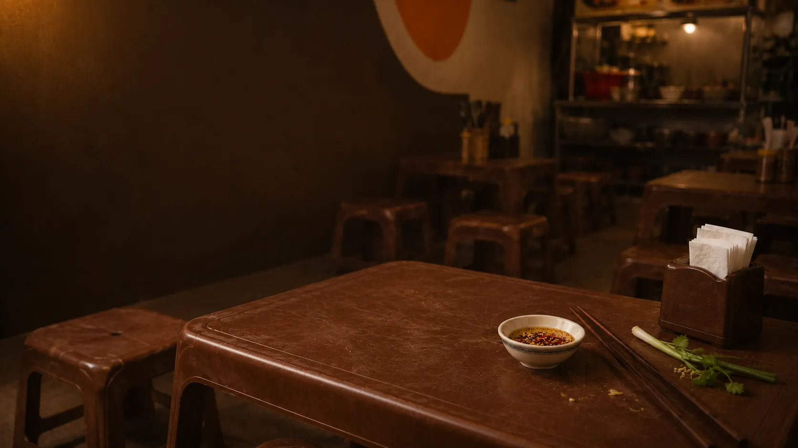

# 04 — SECTION: STORY (CÂU CHUYỆN DI SẢN HÀNG GÒN)

## 1. Ý Nghĩa Từ Ngữ & Sứ Mệnh (Semantics & Purpose)
- **Sứ mệnh**: Truyền tải chiều sâu văn hóa ẩm thực và bề dày lịch sử. Giúp thực khách thấu hiểu rằng mỗi tô bánh canh họ đang thưởng thức không chỉ là một bữa ăn nhanh, mà là một mảnh ký ức quê hương được gìn giữ qua nhiều thế hệ.
- **Giải nghĩa câu chuyện & biểu tượng**:
  - *"Hàng Gòn"*: Địa danh gắn liền với vùng đất đỏ Đông Nam Bộ bình yên, nơi những gánh bánh canh xưa nuôi lớn bao thế hệ người lao động bằng vị ngọt của xương gà và sợi bột gạo xắt tay.
  - *"Chúng tôi giữ vị quê mộc mạc và giản dị trong từng bát canh nóng"*: Tôn chỉ gìn giữ công thức nguyên bản, không thỏa hiệp với các chất phụ gia công nghiệp hay hương liệu nhân tạo.

---

## 2. Bố Cục & Wireframe (Layout Architecture)

### Trên Website Desktop (>= 1024px, 1440px)
- **Cấu trúc**: `<section id="story">` định dạng khung trượt nghệ thuật `.story-slider`.
- **Phân lớp hiển thị**:
  - `Ảnh nền`: `images/story/background_result.webp` bao phủ toàn bộ khung cảnh mộc mạc của quán.
  - `Khối nội dung (.story-slide__content)`: Nằm ở vị trí trung tâm hoặc góc dưới với lớp nền mờ điện ảnh.
  - `Câu trích dẫn (.story-slide__quote)`: Kiểu chữ *Cormorant Garamond* in nghiêng thanh lịch, chữ *Hàng Gòn* được nhấn mạnh (`<em>Hàng Gòn</em>`).

### Trên Website App Mobile (< 768px, 390px)
- Tối ưu hóa kích thước phông chữ và khoảng đệm để câu trích dẫn vừa vặn trong tầm mắt, không che lấp chi tiết nền ảnh.
- Hỗ trợ cử chỉ vuốt chạm cảm ứng (`Touch Gestures`).

---

## 3. Bộ Asset & Hình Ảnh Liên Quan (Assets & Paths)

| Tên File | Đường Dẫn Thực Tế | Định Dạng / Kích Thước | Mục Đích |
| :--- | :--- | :--- | :--- |
| **Ảnh nền Di sản** | `images/story/background_result.webp` | WebP nén tối ưu | Hình ảnh tư liệu không gian mộc mạc và linh hồn gánh canh Hàng Gòn |

---

## 4. Hiệu Ứng & Trạng Thái Tương Tác (Interactions & Motion)
1. **Carousel & Slider Tự Động**: Chuyển slide êm dịu theo chu kỳ 7 giây (`setInterval`).
2. **Tương tác cảm ứng thông minh**:
   - Tự động tạm dừng (`pauseStoryCarousel`) khi người dùng rê chuột vào (`mouseenter`) hoặc chạm ngón tay giữ màn hình (`touchstart`).
   - Hỗ trợ vuốt ngang (`pointerdown` & `pointerup`) với ngưỡng dịch chuyển 48px để đổi câu chuyện.

---

## 5. Ranh Giới Cô Lập (Isolation Boundary)
- **Dải HTML trong `index.html`**:
  ```html
  <!-- SECTION 3: STORY -->
  <section id="story">
    <div class="story-slider" aria-label="Câu chuyện Hàng Gòn">
      <article class="story-slide is-active">
        
        <div class="story-slide__content">
          <p class="story-slide__quote">“Góc chợ <em>Hàng Gòn</em> chứng kiến bao thế hệ. Chúng tôi giữ vị quê mộc mạc và giản dị trong từng bát canh nóng.”</p>
        </div>
      </article>
    </div>
  </section>
  ```
- **Dải CSS trong `<style>`**:
  - Toàn bộ các quy tắc bắt đầu bằng `#story`, `.story-slider`, `.story-slide`, `.story-slide__content`, `.story-slide__quote`.
- **Cam kết**: Giữ nguyên trạng ngữ cảnh và biến script điều khiển slider, không can thiệp vào Section Menu tiếp theo.

---

## 6. Checklist Nghiệm Thu Section (Verification Checklist)
- [ ] Ảnh `images/story/background_result.webp` hiển thị trọn vẹn, không bị lỗi 404.
- [ ] Câu trích dẫn hiển thị đúng phông chữ serif có chân sang trọng, dấu ngoặc kép nghệ thuật.
- [ ] Cử chỉ vuốt chạm trên màn hình điện thoại mượt mà, không gây đứng trang.

